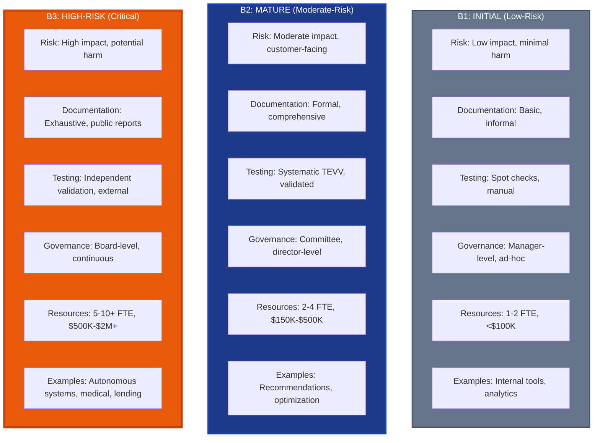
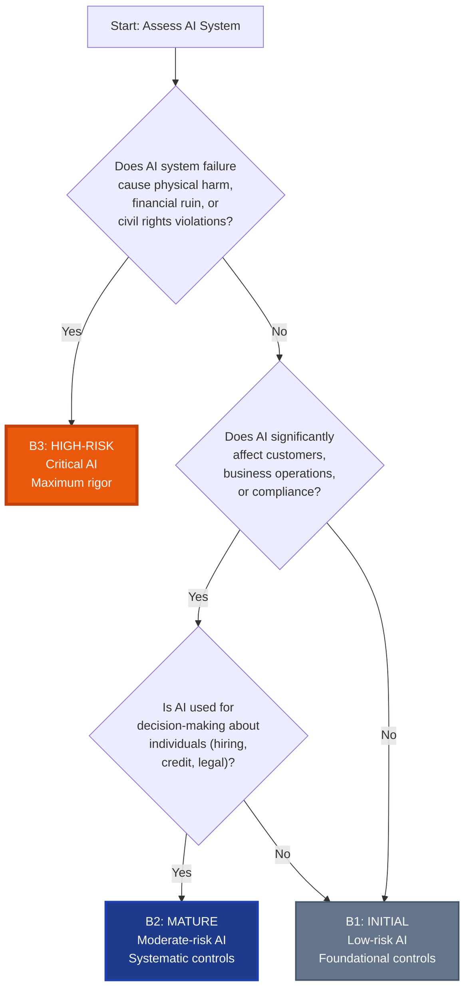

# AI Management Framework (AIMF) by PraeSyn
## Baseline Comparison Infographic Specification

**© 2026 PraeSyn, LLC. All rights reserved.**
Licensed under CC BY-NC-ND 4.0

**Version**: 1.0
**Publication Date**: January 29, 2026
**Status**: Pre-Publication (Working Draft)
**Document Type**: Visual Asset Specification

---

## Infographic Overview

**Purpose**: Compare the three implementation tiers (B1, B2, B3) showing requirements, scope, and use cases at a glance.

**Recommended Format**: Vertical three-column comparison chart (portrait orientation, 800x1200 or similar)

**Visual Style**: Three distinct columns with consistent structure, color-coded for easy differentiation

---

## Tier Color Scheme

**B1: Initial**
- Primary: Gray (#64748B)
- Accent: Light Blue (#94A3B8)
- Badge: "Foundational"

**B2: Mature**
- Primary: Blue (#1E3A8A)
- Accent: Medium Blue (#3B82F6)
- Badge: "Systematic"

**B3: High-Risk**
- Primary: Orange (#EA580C)
- Accent: Dark Orange (#C2410C)
- Badge: "Maximum Rigor"

---

## Three-Column Comparison Layout

### Header Row: Tier Identification

```
┌──────────────────────┬──────────────────────┬──────────────────────┐
│   B1: INITIAL        │   B2: MATURE         │   B3: HIGH-RISK      │
│   Foundational       │   Systematic         │   Maximum Rigor      │
│   ░░░░░░░░░░         │   ████████           │   ▓▓▓▓▓▓▓▓▓▓         │
└──────────────────────┴──────────────────────┴──────────────────────┘
```

---

### Row 1: Risk Level

**B1: Initial**
- Icon: ⚠️ Low Risk
- Description: "Low-risk AI systems with minimal impact on individuals or operations"
- Examples:
  - Internal chatbots
  - Data analytics tools
  - Non-customer-facing AI

**B2: Mature**
- Icon: ⚠️⚠️ Moderate Risk
- Description: "Moderate-risk AI affecting business operations or customer decisions"
- Examples:
  - Customer-facing recommendations
  - Business process automation
  - Operational optimization

**B3: High-Risk**
- Icon: ⚠️⚠️⚠️ High Risk
- Description: "High-risk or critical AI systems where failure causes significant harm"
- Examples:
  - Autonomous vehicles
  - Medical diagnostics
  - Credit decisioning
  - Critical infrastructure

---

### Row 2: Documentation Requirements

**B1: Initial**
- Basic documentation
- Simple policies
- Informal procedures
- Minimal records

**B2: Mature**
- Formal documentation
- Comprehensive policies
- Documented procedures
- Regular records
- Version control

**B3: High-Risk**
- Exhaustive documentation
- Legal-grade policies
- Detailed procedures
- Complete audit trail
- Public transparency reports
- Research-grade rigor

---

### Row 3: Testing & Validation

**B1: Initial**
- Basic functional testing
- Spot checks
- Manual validation
- Simple metrics
- Annual reviews

**B2: Mature**
- Comprehensive TEVV
- Systematic testing
- Validated metrics
- Regular audits
- Quarterly reviews
- Documented test plans

**B3: High-Risk**
- Independent validation
- External expert review
- Research-grade methodology
- Continuous monitoring
- Real-time dashboards
- Red team testing
- Monthly or continuous reviews

---

### Row 4: Governance & Oversight

**B1: Initial**
- Basic accountability
- Part-time oversight
- Informal reviews
- Manager-level decisions
- Ad-hoc meetings

**B2: Mature**
- Formal accountability
- Governance committee
- Regular reviews
- Director-level decisions
- Quarterly governance meetings
- Stakeholder input

**B3: High-Risk**
- Board-level oversight
- Independent oversight function
- Continuous monitoring
- Executive-level decisions
- Monthly governance meetings
- External advisory board
- Public accountability

---

### Row 5: Stakeholder Engagement

**B1: Initial**
- Internal awareness
- Basic communication
- Limited feedback
- As-needed engagement

**B2: Mature**
- Systematic engagement
- Regular feedback collection
- Documented input
- Planned stakeholder sessions
- Feedback integration process

**B3: High-Risk**
- Comprehensive engagement
- Continuous feedback loops
- Public consultation
- Independent advocacy representation
- Transparent decision records
- Appeal processes

---

### Row 6: Fairness & Bias

**B1: Initial**
- Basic awareness
- Informal checks
- Limited testing
- Reactive responses

**B2: Mature**
- Systematic testing
- Multiple fairness metrics
- Regular assessments
- Documented analysis
- Mitigation plans

**B3: High-Risk**
- Independent fairness assessment
- Intersectional analysis
- Continuous monitoring
- Public reporting
- Academic-level rigor
- External validation

---

### Row 7: Incident Response

**B1: Initial**
- Basic incident logging
- Manual response
- Informal procedures
- Best-effort timeline

**B2: Mature**
- Formal incident response plan
- Documented procedures
- Defined SLAs
- Root cause analysis
- Lessons learned process

**B3: High-Risk**
- 24/7 monitoring
- Automated alerting
- Emergency response team
- Public notification requirements
- Independent investigation
- Regulatory reporting
- <4 hour response time for critical incidents

---

### Row 8: Resources & Budget

**B1: Initial**
- **Team**: 1-2 FTE (part-time)
- **Budget**: <$100K annually
- **Tools**: Basic/free tools
- **Timeline**: 3-6 months implementation

**B2: Mature**
- **Team**: 2-4 FTE (dedicated)
- **Budget**: $150K-$500K annually
- **Tools**: Commercial governance platforms
- **Timeline**: 6-12 months implementation

**B3: High-Risk**
- **Team**: 5-10+ FTE (dedicated + specialists)
- **Budget**: $500K-$2M+ annually
- **Tools**: Enterprise platforms + external experts
- **Timeline**: 12-24 months implementation

---

### Row 9: Regulatory Compliance

**B1: Initial**
- Basic awareness
- Essential compliance only
- Reactive to requirements
- Standard industry practices

**B2: Mature**
- Comprehensive compliance program
- Proactive monitoring
- Regular audits
- Industry-specific requirements
- External assessments

**B3: High-Risk**
- Maximum compliance rigor
- Continuous regulatory monitoring
- Independent audits
- Anticipatory compliance
- Regulatory engagement
- Public compliance reporting
- Certification readiness

---

### Row 10: Use Case Examples

**B1: Initial**
```
✓ Internal productivity tools
✓ Data visualization dashboards
✓ Basic automation scripts
✓ Non-customer-facing analytics
✓ Development/testing environments
```

**B2: Mature**
```
✓ Customer product recommendations
✓ Business process optimization
✓ Predictive maintenance (non-critical)
✓ Marketing personalization
✓ Customer service chatbots
✓ Fraud detection (human review)
```

**B3: High-Risk**
```
✓ Autonomous vehicles
✓ Medical diagnosis/treatment AI
✓ Credit/lending decisions
✓ Hiring/employment decisions
✓ Criminal justice risk assessment
✓ Critical infrastructure control
✓ Life-safety systems
```

---

## Mermaid Diagram Code (Comparison Table)



---

## Text-Based Baseline Comparison Table

```
┌──────────────────────┬────────────────────────┬────────────────────────┬────────────────────────┐
│ Criterion            │ B1: INITIAL            │ B2: MATURE             │ B3: HIGH-RISK          │
│                      │ Foundational           │ Systematic             │ Maximum Rigor          │
├──────────────────────┼────────────────────────┼────────────────────────┼────────────────────────┤
│ Risk Level           │ ⚠️ Low                 │ ⚠️⚠️ Moderate          │ ⚠️⚠️⚠️ High            │
│                      │ Minimal impact         │ Customer-facing        │ Life-safety, critical  │
├──────────────────────┼────────────────────────┼────────────────────────┼────────────────────────┤
│ Documentation        │ Basic                  │ Formal                 │ Exhaustive             │
│                      │ Simple policies        │ Comprehensive policies │ Legal-grade            │
│                      │ Informal procedures    │ Documented procedures  │ Public transparency    │
├──────────────────────┼────────────────────────┼────────────────────────┼────────────────────────┤
│ Testing &            │ Basic functional       │ Comprehensive TEVV     │ Independent validation │
│ Validation           │ Spot checks            │ Systematic testing     │ External expert review │
│                      │ Annual reviews         │ Quarterly reviews      │ Continuous monitoring  │
├──────────────────────┼────────────────────────┼────────────────────────┼────────────────────────┤
│ Governance           │ Manager-level          │ Governance committee   │ Board-level oversight  │
│                      │ Ad-hoc meetings        │ Quarterly meetings     │ Monthly reviews        │
│                      │ Part-time oversight    │ Formal accountability  │ Independent function   │
├──────────────────────┼────────────────────────┼────────────────────────┼────────────────────────┤
│ Stakeholder          │ Internal awareness     │ Systematic engagement  │ Comprehensive public   │
│ Engagement           │ Limited feedback       │ Regular feedback       │ Continuous loops       │
│                      │ As-needed              │ Planned sessions       │ Appeal processes       │
├──────────────────────┼────────────────────────┼────────────────────────┼────────────────────────┤
│ Fairness & Bias      │ Basic awareness        │ Systematic testing     │ Independent assessment │
│                      │ Informal checks        │ Multiple metrics       │ Intersectional analysis│
│                      │ Reactive               │ Regular assessments    │ Public reporting       │
├──────────────────────┼────────────────────────┼────────────────────────┼────────────────────────┤
│ Incident Response    │ Basic logging          │ Formal response plan   │ 24/7 monitoring        │
│                      │ Manual response        │ Defined SLAs           │ Emergency response team│
│                      │ Best-effort timeline   │ Root cause analysis    │ <4 hr critical response│
├──────────────────────┼────────────────────────┼────────────────────────┼────────────────────────┤
│ Resources            │ 1-2 FTE (part-time)    │ 2-4 FTE (dedicated)    │ 5-10+ FTE (specialists)│
│                      │ <$100K annually        │ $150K-$500K annually   │ $500K-$2M+ annually    │
│                      │ Basic/free tools       │ Commercial platforms   │ Enterprise + external  │
├──────────────────────┼────────────────────────┼────────────────────────┼────────────────────────┤
│ Implementation       │ 3-6 months             │ 6-12 months            │ 12-24 months           │
│ Timeline             │                        │                        │                        │
├──────────────────────┼────────────────────────┼────────────────────────┼────────────────────────┤
│ Regulatory           │ Basic awareness        │ Comprehensive program  │ Maximum compliance     │
│ Compliance           │ Essential only         │ Proactive monitoring   │ Continuous monitoring  │
│                      │ Reactive               │ Regular audits         │ Independent audits     │
├──────────────────────┼────────────────────────┼────────────────────────┼────────────────────────┤
│ Example              │ • Internal tools       │ • Recommendations      │ • Autonomous vehicles  │
│ Use Cases            │ • Analytics dashboards │ • Process optimization │ • Medical diagnosis    │
│                      │ • Dev environments     │ • Customer chatbots    │ • Credit decisions     │
│                      │ • Non-customer AI      │ • Fraud detection      │ • Life-safety systems  │
└──────────────────────┴────────────────────────┴────────────────────────┴────────────────────────┘
```

---

## Decision Flowchart: Which Tier?



---

## Visual Emphasis Elements

### Icons for Each Tier

**B1: Initial**
- 🔰 Shield with "1" (foundational protection)
- 📝 Document (basic documentation)
- ⚡ Lightning (quick implementation)

**B2: Mature**
- 🛡️ Strong shield with "2" (systematic protection)
- 📊 Charts (metrics and monitoring)
- 🔄 Cycle (continuous process)

**B3: High-Risk**
- 🛡️🔒 Locked shield with "3" (maximum protection)
- 🔍 Magnifying glass (intense scrutiny)
- 🏛️ Building (institutional oversight)

---

## Tier Transition Paths

**Moving Up Tiers** (when risk increases):
```
B1 → B2: Add systematic processes, increase documentation, establish governance committee
        Timeline: 3-6 months
        Investment: +$50K-$200K, +1-2 FTE

B2 → B3: Add independent validation, board oversight, public accountability
        Timeline: 6-12 months
        Investment: +$200K-$1M+, +3-6 FTE
```

**Rightsizing Tiers** (when risk decreases):
```
B3 → B2: Appropriate for moderate-risk AI that no longer requires maximum rigor
        Decision: Risk acceptance by executives, document justification

B2 → B1: For AI that becomes low-impact or non-critical
        Decision: Risk acceptance, maintain essential controls only
```

---

## Usage Guidelines

**For Risk Assessment**:
- Use decision flowchart to determine appropriate tier
- Document tier assignment rationale
- Review tier assignments annually

**For Budget Planning**:
- Resource estimates guide budget discussions
- Show cost difference between tiers
- Justify tier selection with risk analysis

**For Stakeholder Communication**:
- Simple three-column comparison for executives
- Visual clarity on "what changes at each tier"
- Emphasize risk mitigation at higher tiers

**For Implementation Planning**:
- Use as requirement checklist for each tier
- Timeline guidance for project planning
- Resource allocation estimates

---

**AI Management Framework (AIMF) by PraeSyn**

*This tier comparison infographic should help organizations select and implement the appropriate rigor level for their AI systems based on risk, resources, and regulatory requirements.*
