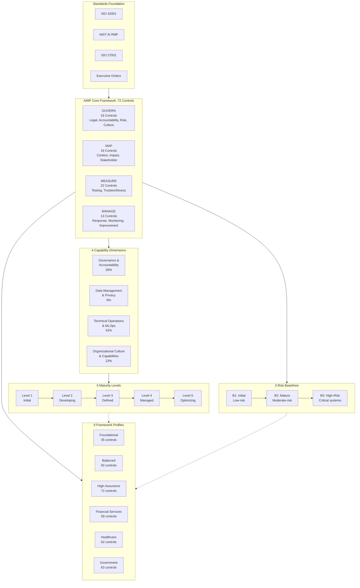

# AI Management Framework (AIMF) by PraeSyn
## Framework Architecture Diagram Specification

**© 2026 PraeSyn, LLC. All rights reserved.**
Licensed under CC BY-NC-ND 4.0

**Version**: 1.0
**Publication Date**: January 29, 2026
**Status**: Pre-Publication (Working Draft)
**Document Type**: Visual Asset Specification

---

## Diagram Overview

**Purpose**: Illustrate the complete AIMF architecture showing the relationship between maturity levels, capability dimensions, implementation tiers, and the control framework.

**Recommended Format**: High-resolution infographic (1920x1080 or larger), suitable for presentations and documentation

**Color Palette**:
- Primary Blue: #1E3A8A (governance/structure)
- Accent Teal: #0D9488 (progression/growth)
- Warning Orange: #EA580C (high-risk/B3)
- Neutral Gray: #64748B (supporting elements)
- White/Light Gray: #F8FAFC (background)

---

## Diagram Structure

### Layer 1: Foundation (Bottom)
**Title**: "Standards Foundation"

**Elements**:
- ISO 42001 logo/reference (center-left)
- NIST AI RMF logo/reference (center-right)
- ISO 27001 reference (left)
- Executive Orders 14110/14179 reference (right)

**Visual Treatment**: Foundational pillars or base layer with connecting lines showing integration

**Text**: "Built on internationally recognized standards and regulatory frameworks"

---

### Layer 2: Core Framework Structure (Middle-Lower)
**Title**: "72 Controls Across 4 Functions"

**Four-Column Layout**:

**Column 1: GOVERN** (19 controls)
- Icon: Shield or governance symbol
- Color: Dark Blue (#1E3A8A)
- Sub-elements:
  - Legal & Compliance
  - Accountability & Structure
  - Risk Management
  - Culture & Engagement
  - Resources & Capabilities

**Column 2: MAP** (19 controls)
- Icon: Compass or map symbol
- Color: Teal (#0D9488)
- Sub-elements:
  - Context & Requirements
  - Categorization & Boundaries
  - Impact Assessment
  - Stakeholder Engagement
  - Third-Party Risk

**Column 3: MEASURE** (22 controls)
- Icon: Measurement/metrics symbol
- Color: Purple (#7C3AED)
- Sub-elements:
  - Testing & TEVV
  - Performance Metrics
  - Trustworthiness (Safety, Security, Privacy, Fairness)
  - Transparency & Explainability

**Column 4: MANAGE** (13 controls)
- Icon: Cycle/feedback symbol
- Color: Green (#059669)
- Sub-elements:
  - Risk Response
  - Incident Management
  - Third-Party Monitoring
  - Continuous Improvement

**Visual Treatment**: Four vertical columns of equal width, clearly separated, with control counts prominently displayed

---

### Layer 3: Capability Dimensions (Middle-Upper)
**Title**: "4 Capability Dimensions"

**Horizontal Layout Across All Functions**:

**Dimension 1: Governance & Accountability** (26% of controls)
- Icon: Organizational chart
- Color accent: Blue
- Maps to: Primarily GOVERN, some MAP/MEASURE/MANAGE

**Dimension 2: Data Management & Privacy** (8% of controls)
- Icon: Database with lock
- Color accent: Purple
- Maps to: Primarily MEASURE (privacy), some MAP

**Dimension 3: Technical Operations & MLOps** (42% of controls)
- Icon: Gears or pipeline
- Color accent: Teal
- Maps to: MEASURE and MANAGE primarily

**Dimension 4: Organizational Culture & Capabilities** (23% of controls)
- Icon: People/team
- Color accent: Orange
- Maps to: GOVERN, MAP stakeholder engagement

**Visual Treatment**: Horizontal overlay showing how dimensions span across functions

---

### Layer 4: Maturity Progression (Top)
**Title**: "5 Maturity Levels"

**Horizontal Progression** (Left to Right):

**Level 1: Initial**
- Icon: Single dot
- Color: Light gray
- Descriptor: "Ad-hoc, reactive"

**Level 2: Developing**
- Icon: Two dots
- Color: Gray-blue
- Descriptor: "Foundational structure"

**Level 3: Defined**
- Icon: Three dots
- Color: Blue
- Descriptor: "Systematic processes"

**Level 4: Managed**
- Icon: Four dots
- Color: Teal
- Descriptor: "Data-driven optimization"

**Level 5: Optimizing**
- Icon: Five dots
- Color: Green
- Descriptor: "Continuous innovation"

**Visual Treatment**: Stepped progression or ascending path with arrow showing advancement direction

---

### Layer 5: Risk Baselines (Right Side)
**Title**: "3 Risk Baselines"

**Vertical Stack**:

**B3: High-Risk**
- Color: Orange (#EA580C)
- Badge: "Maximum Rigor"
- Descriptor: "Critical AI systems"
- Requirements: Independent validation, public transparency, research-grade methodology

**B2: Mature**
- Color: Blue (#1E3A8A)
- Badge: "Systematic"
- Descriptor: "Moderate-risk AI"
- Requirements: Formal documentation, regular reviews, stakeholder input

**B1: Initial**
- Color: Gray (#64748B)
- Badge: "Foundational"
- Descriptor: "Low-risk AI"
- Requirements: Basic policies, awareness, essential controls

**Visual Treatment**: Vertical progression showing increasing rigor, with visual distinction between tiers

---

### Central Integration Element
**Title**: "Profiles: Customize for Your Context"

**Element**: Central hexagon or badge connecting all layers

**Profile Examples** (radiating from center or listed):
- Foundational (35 controls, B1)
- Balanced (50 controls, B2)
- High-Assurance (72 controls, B3)
- Financial Services (59 controls)
- Healthcare (62 controls)
- Government (63 controls)

**Visual Treatment**: Central element showing how profiles select controls, assign tiers, and target maturity levels

---

## Mermaid Diagram Code (Simplified Architecture)



---

## Alternative Visualization: Layered Pyramid

**Structure**:
- **Base**: Standards (ISO 42001, NIST AI RMF, ISO 27001)
- **Layer 2**: 72 Controls (4 Functions × 19/22/13 controls)
- **Layer 3**: 4 Capability Dimensions (cross-cutting)
- **Layer 4**: 3 Risk Baselines (rigor levels)
- **Layer 5**: 5 Maturity Levels (organizational capability)
- **Peak**: 6 Framework Profiles (customization)

**Visual Treatment**: Pyramid showing progression from foundational standards to customized implementation

---

## Text-Based Architecture Summary

```
┌─────────────────────────────────────────────────────────────────────┐
│  AI MANAGEMENT FRAMEWORK (AIMF) BY PRAESYN - ARCHITECTURE           │
└─────────────────────────────────────────────────────────────────────┘

┌─────────────────────────────────────────────────────────────────────┐
│  6 FRAMEWORK PROFILES                                                │
│  ┌───────────┬───────────┬────────────┬──────────┬──────────────┐   │
│  │Foundation │ Balanced  │High-       │Financial │Healthcare │Gov│   │
│  │35 ctrls   │50 ctrls   │Assurance   │Services  │62 ctrls   │63 │   │
│  │B1         │B2         │72 ctrls B3 │59 ctrls  │B2-B3      │   │   │
│  └───────────┴───────────┴────────────┴──────────┴──────────────┘   │
└─────────────────────────────────────────────────────────────────────┘

┌─────────────────────────────────────────────────────────────────────┐
│  5 MATURITY LEVELS (Organizational Capability Assessment)            │
│  Initial → Developing → Defined → Managed → Optimizing              │
└─────────────────────────────────────────────────────────────────────┘

┌─────────────────────────────────────────────────────────────────────┐
│  3 IMPLEMENTATION TIERS (Control Rigor)        │ B1: Initial         │
│  ┌──────────────────────────────────────────┐  │ B2: Mature          │
│  │ B3: High-Risk    │ Maximum rigor         │  │ B3: High-Risk       │
│  │ B2: Mature       │ Systematic programs   │  └─────────────────────┘
│  │ B1: Initial      │ Foundational         │
│  └──────────────────────────────────────────┘
└─────────────────────────────────────────────────────────────────────┘

┌─────────────────────────────────────────────────────────────────────┐
│  4 CAPABILITY DIMENSIONS (Cross-Cutting Organizational Views)        │
│  ┌──────────────┬──────────────┬──────────────┬──────────────┐      │
│  │ Governance & │ Data Mgmt    │ Technical    │ Org Culture  │      │
│  │ Accountability│ & Privacy   │ Ops & MLOps  │ & Capability │      │
│  │ 26%          │ 8%           │ 42%          │ 23%          │      │
│  └──────────────┴──────────────┴──────────────┴──────────────┘      │
└─────────────────────────────────────────────────────────────────────┘

┌─────────────────────────────────────────────────────────────────────┐
│  72 CONTROLS ACROSS 4 FUNCTIONS (NIST AI RMF Aligned)                │
│  ┌──────────┬──────────┬──────────┬──────────┐                      │
│  │ GOVERN   │ MAP      │ MEASURE  │ MANAGE   │                      │
│  │ 19       │ 19       │ 22       │ 13       │                      │
│  │ controls │ controls │ controls │ controls │                      │
│  └──────────┴──────────┴──────────┴──────────┘                      │
└─────────────────────────────────────────────────────────────────────┘

┌─────────────────────────────────────────────────────────────────────┐
│  STANDARDS FOUNDATION                                                │
│  ┌──────────┬──────────┬──────────┬──────────────────┐              │
│  │ ISO      │ NIST AI  │ ISO      │ Executive Orders │              │
│  │ 42001    │ RMF 1.0  │ 27001    │ 14110/14179      │              │
│  └──────────┴──────────┴──────────┴──────────────────┘              │
└─────────────────────────────────────────────────────────────────────┘
```

---

## Usage Guidelines

**For Presentations**:
- Use full-color version for slides and reports
- Ensure text is readable at projected size (minimum 18pt font)
- Consider animated version revealing layers progressively

**For Documentation**:
- High-resolution PNG or SVG for print materials
- Interactive version for web documentation (clickable elements)
- Simplified version for quick reference cards

**For Training Materials**:
- Build-up animation showing each layer
- Highlight different paths (e.g., small business using Foundational Profile at B1)
- Use as anchor diagram with drill-down to specific components

---

**AI Management Framework (AIMF) by PraeSyn**

*This diagram specification provides the structure for creating professional visual assets. Actual graphic design should follow corporate branding guidelines while maintaining clarity and educational value.*
