# AI Management Framework (AIMF) by PraeSyn
## Maturity Progression Diagram Specification

**© 2026 PraeSyn, LLC. All rights reserved.**
Licensed under CC BY-NC-ND 4.0

**Version**: 1.0
**Publication Date**: January 29, 2026
**Status**: Pre-Publication (Working Draft)
**Document Type**: Visual Asset Specification

---

## Diagram Overview

**Purpose**: Illustrate the 5 maturity levels with characteristics, progression paths, and typical timelines for advancement.

**Recommended Format**: Horizontal progression infographic (landscape orientation, 1920x600 or wider)

**Visual Style**: Path or staircase progression showing advancement from Level 1 to Level 5

---

## Maturity Level Specifications

### Level 1: Initial (Ad-Hoc)
**Color**: Light Gray (#9CA3AF)
**Icon**: Single circle or dot
**Shape**: Small base step

**Characteristics**:
- Ad-hoc AI usage
- Reactive approach
- Minimal documentation
- Individual heroics
- Informal processes

**Typical Behaviors**:
- "We're just trying things out"
- "AI is someone's side project"
- "No formal policies yet"
- "Learning as we go"

**Visual Elements**:
- Smallest/lowest element in progression
- Dotted or light outline (incomplete)
- Minimal visual complexity

---

### Level 2: Developing (Foundational)
**Color**: Gray-Blue (#64748B)
**Icon**: Two circles
**Shape**: Second step, noticeably higher

**Characteristics**:
- Basic structure established
- Documented awareness
- Initial policies
- Assigned roles (part-time)
- Foundational practices

**Typical Behaviors**:
- "We have a governance document"
- "Someone is responsible for AI governance"
- "We track our AI systems"
- "Basic risk assessments completed"

**Transition from Level 1**: 3-6 months with Foundational Profile
**Investment**: Low (1-2 FTE, <$100K)

**Visual Elements**:
- Solid outline, basic fill
- Simple connecting arrow from Level 1
- Modest increase in visual weight

---

### Level 3: Defined (Systematic)
**Color**: Blue (#1E3A8A)
**Icon**: Three circles
**Shape**: Middle step, clear progression

**Characteristics**:
- Formal processes documented
- Systematic governance
- Regular reviews
- Dedicated team (part-time to full-time)
- Stakeholder engagement

**Typical Behaviors**:
- "We have repeatable processes"
- "Governance committee meets regularly"
- "All AI systems have risk assessments"
- "We follow documented procedures"

**Transition from Level 2**: 6-12 months with Balanced Profile
**Investment**: Medium (2-4 FTE, $150K-$300K)

**Visual Elements**:
- Richer color, more detail
- Multiple connecting elements showing structured processes
- Balanced visual presence (middle of progression)

---

### Level 4: Managed (Data-Driven)
**Color**: Teal (#0D9488)
**Icon**: Four circles
**Shape**: Fourth step, approaching peak

**Characteristics**:
- Quantitative management
- Metrics-driven decisions
- Continuous monitoring
- Predictive analytics
- Process optimization

**Typical Behaviors**:
- "We measure governance effectiveness"
- "Data drives our AI risk decisions"
- "We predict and prevent issues"
- "Automated monitoring and alerting"

**Transition from Level 3**: 12-18 months with advanced practices
**Investment**: High (4-6 FTE, $500K+)

**Visual Elements**:
- Vibrant color showing maturity
- Data/metrics iconography (charts, dashboards)
- Broader visual footprint

---

### Level 5: Optimizing (Innovation)
**Color**: Green (#059669)
**Icon**: Five circles (or star)
**Shape**: Peak/summit of progression

**Characteristics**:
- Continuous innovation
- Industry leadership
- Advanced research participation
- Organizational learning culture
- Proactive risk anticipation

**Typical Behaviors**:
- "We innovate governance practices"
- "We contribute to industry standards"
- "Our AI governance is competitive advantage"
- "We anticipate risks before they emerge"

**Transition from Level 4**: 18+ months of sustained excellence
**Investment**: Very High (6+ FTE, $1M+ with research programs)

**Visual Elements**:
- Brightest/most vibrant color
- Peak position with visual "glow" or emphasis
- Innovation symbols (lightbulb, forward arrows)

---

## Progression Path Visual Elements

### Connecting Arrows Between Levels
- **Level 1 → 2**: Simple arrow, labeled "Foundational Profile (3-6 months)"
- **Level 2 → 3**: Thicker arrow, labeled "Balanced Profile (6-12 months)"
- **Level 3 → 4**: Complex arrow, labeled "Advanced Practices (12-18 months)"
- **Level 4 → 5**: Refined arrow, labeled "Continuous Excellence (18+ months)"

### Milestones Along Path
- Document key achievements at each transition
- Show typical duration ranges
- Indicate resource requirements

---

## Mermaid Diagram Code

```mermaid
graph LR
    L1["Level 1: Initial<br/>Ad-hoc, Reactive<br/><br/>Characteristics:<br/>• Minimal documentation<br/>• Informal processes<br/>• Individual efforts"]

    L2["Level 2: Developing<br/>Foundational Structure<br/><br/>Characteristics:<br/>• Basic policies<br/>• Assigned roles<br/>• Documented awareness"]

    L3["Level 3: Defined<br/>Systematic Processes<br/><br/>Characteristics:<br/>• Formal processes<br/>• Regular reviews<br/>• Dedicated team"]

    L4["Level 4: Managed<br/>Data-Driven<br/><br/>Characteristics:<br/>• Quantitative management<br/>• Continuous monitoring<br/>• Process optimization"]

    L5["Level 5: Optimizing<br/>Continuous Innovation<br/><br/>Characteristics:<br/>• Industry leadership<br/>• Advanced research<br/>• Proactive anticipation"]

    L1 -->|"Foundational Profile<br/>3-6 months<br/>1-2 FTE"| L2
    L2 -->|"Balanced Profile<br/>6-12 months<br/>2-4 FTE"| L3
    L3 -->|"Advanced Practices<br/>12-18 months<br/>4-6 FTE"| L4
    L4 -->|"Continuous Excellence<br/>18+ months<br/>6+ FTE"| L5

    style L1 fill:#9CA3AF,stroke:#6B7280,stroke-width:2px,color:#000
    style L2 fill:#64748B,stroke:#475569,stroke-width:2px,color:#fff
    style L3 fill:#1E3A8A,stroke:#1E40AF,stroke-width:3px,color:#fff
    style L4 fill:#0D9488,stroke:#0F766E,stroke-width:3px,color:#fff
    style L5 fill:#059669,stroke:#047857,stroke-width:4px,color:#fff
```



---

## Alternative Visualization: Staircase

```
                                    ┌──────────────────┐
                                    │  Level 5         │
                                    │  OPTIMIZING      │
                                    │  Innovation      │
                             ┌──────┴──────────────────┤
                             │  Level 4                │
                             │  MANAGED                │
                             │  Data-Driven            │
                      ┌──────┴─────────────────────────┤
                      │  Level 3                       │
                      │  DEFINED                       │
                      │  Systematic                    │
               ┌──────┴────────────────────────────────┤
               │  Level 2                              │
               │  DEVELOPING                           │
               │  Foundational                         │
        ┌──────┴───────────────────────────────────────┤
        │  Level 1                                     │
        │  INITIAL                                     │
        │  Ad-hoc                                      │
        └──────────────────────────────────────────────┘

    Timeline:    3-6 mo   6-12 mo   12-18 mo   18+ mo
    Investment:  Low      Medium    High       Very High
```

---

## Dimensional View: Radar Chart

For each maturity level, show assessment across 4 dimensions:

**Radar Chart Layout** (5 overlapping pentagons, one per maturity level):

**Axes**:
1. Governance & Accountability (0-5 scale)
2. Data Management & Privacy (0-5 scale)
3. Technical Operations & MLOps (0-5 scale)
4. Organizational Culture & Capabilities (0-5 scale)

**Level 1 Profile** (innermost, smallest):
- Governance: 1
- Data: 1
- Technical: 1
- Culture: 1

**Level 2 Profile**:
- Governance: 2
- Data: 2
- Technical: 2
- Culture: 2

**Level 3 Profile** (middle):
- Governance: 3
- Data: 3
- Technical: 3
- Culture: 3

**Level 4 Profile**:
- Governance: 4
- Data: 4
- Technical: 4
- Culture: 4

**Level 5 Profile** (outermost, largest):
- Governance: 5
- Data: 5
- Technical: 5
- Culture: 5

**Visual Treatment**: Concentric polygons showing balanced growth across all dimensions

---

## Text-Based Maturity Comparison Table

```
┌────────────┬──────────────┬──────────────┬──────────────┬──────────────┬──────────────┐
│ Aspect     │ Level 1      │ Level 2      │ Level 3      │ Level 4      │ Level 5      │
│            │ INITIAL      │ DEVELOPING   │ DEFINED      │ MANAGED      │ OPTIMIZING   │
├────────────┼──────────────┼──────────────┼──────────────┼──────────────┼──────────────┤
│ Governance │ Ad-hoc       │ Basic        │ Formal       │ Quantitative │ Innovative   │
│            │ Reactive     │ policies     │ processes    │ metrics      │ Leadership   │
├────────────┼──────────────┼──────────────┼──────────────┼──────────────┼──────────────┤
│ Resources  │ Part-time    │ 1-2 FTE      │ 2-4 FTE      │ 4-6 FTE      │ 6+ FTE       │
│            │ No budget    │ <$100K       │ $150-300K    │ $500K+       │ $1M+         │
├────────────┼──────────────┼──────────────┼──────────────┼──────────────┼──────────────┤
│ Timeline   │ Starting     │ 3-6 months   │ 6-12 months  │ 12-18 months │ 18+ months   │
│            │ point        │ from L1      │ from L2      │ from L3      │ from L4      │
├────────────┼──────────────┼──────────────┼──────────────┼──────────────┼──────────────┤
│ Profile    │ Not ready    │ Foundational │ Balanced     │ Advanced     │ High-        │
│            │ for AIMF     │ (35 controls)│ (50 controls)│ implementation│ Assurance    │
│            │              │              │              │              │ (72 controls)│
├────────────┼──────────────┼──────────────┼──────────────┼──────────────┼──────────────┤
│ Data       │ No data      │ Basic        │ Regular      │ Real-time    │ Predictive   │
│            │ collection   │ tracking     │ reporting    │ dashboards   │ analytics    │
├────────────┼──────────────┼──────────────┼──────────────┼──────────────┼──────────────┤
│ Culture    │ Awareness    │ Learning     │ Engaged      │ Proactive    │ Innovative   │
│            │ emerging     │ culture      │ stakeholders │ anticipation │ mindset      │
└────────────┴──────────────┴──────────────┴──────────────┴──────────────┴──────────────┘
```

---

## Maturity Assessment Indicators

### Visual Indicators for Each Level

**Level 1: Initial**
- ⚠️ Warning icon (risks not managed)
- 🟡 Yellow status indicator
- 📋 "Getting Started" badge

**Level 2: Developing**
- 🔄 Progress icon (improvement in motion)
- 🟡 Yellow-green status indicator
- 🏗️ "Building Foundation" badge

**Level 3: Defined**
- ✅ Check icon (systematic processes)
- 🟢 Green status indicator
- 📊 "Systematic" badge

**Level 4: Managed**
- 📈 Metrics icon (data-driven)
- 🟢 Bright green status indicator
- 🎯 "Optimized" badge

**Level 5: Optimizing**
- ⭐ Star icon (excellence)
- 🟢 Gold-green status indicator
- 🏆 "Industry Leader" badge

---

## Transition Guidance Annotations

**Between Each Level**:
- Show typical challenges (e.g., "Resource constraints" between L2→L3)
- Highlight key success factors (e.g., "Executive commitment" for L3→L4)
- Display average timeline ranges
- Indicate profile recommendations

**Example Annotation (L2 to L3 Transition)**:
```
┌─────────────────────────────────────────┐
│ Level 2 → Level 3 Transition            │
├─────────────────────────────────────────┤
│ Profile: Balanced (50 controls)         │
│ Timeline: 6-12 months                   │
│ Investment: $150K-$300K, 2-4 FTE       │
│                                         │
│ Key Success Factors:                    │
│ • Executive sponsorship                 │
│ • Dedicated governance team             │
│ • Integration with existing processes   │
│                                         │
│ Common Challenges:                      │
│ • Change resistance                     │
│ • Resource allocation                   │
│ • Process adoption                      │
└─────────────────────────────────────────┘
```

---

## Usage Guidelines

**For Assessments**:
- Use to show current state and target state
- Highlight progression path with estimated timelines
- Overlay organization's assessment scores

**For Executive Presentations**:
- Simplified 5-step visual showing "where we are" and "where we're going"
- Emphasis on business benefits at each level
- ROI/risk reduction messaging

**For Implementation Planning**:
- Detailed view with timelines and resources
- Milestone markers for tracking progress
- Integration with tier transition guides

**For Marketing/Communications**:
- Aspirational visualization showing maturity journey
- Success stories at each level
- Industry benchmarking comparison

---

**AI Management Framework (AIMF) by PraeSyn**

*This maturity progression diagram should inspire organizations to advance their AI governance capabilities while providing realistic expectations for timelines and resources required.*
