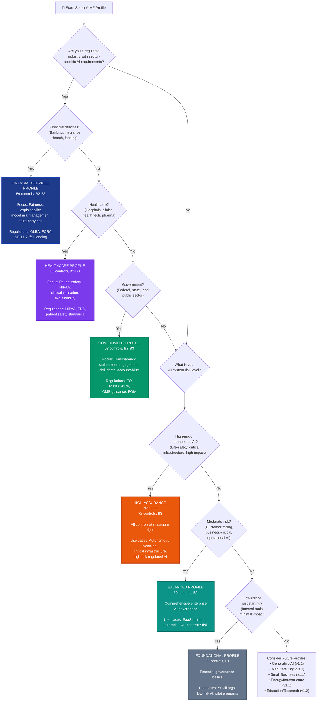
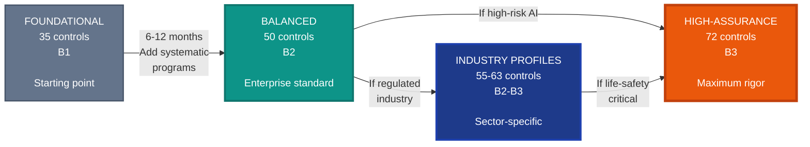

# AI Management Framework (AIMF) by PraeSyn
## Profile Selection Flowchart Specification

**© 2026 PraeSyn, LLC. All rights reserved.**
Licensed under CC BY-NC-ND 4.0

**Version**: 1.0
**Publication Date**: January 29, 2026
**Status**: Pre-Publication (Working Draft)
**Document Type**: Visual Asset Specification

---

## Flowchart Overview

**Purpose**: Guide organizations through systematic profile selection based on industry, risk level, regulatory requirements, and organizational characteristics.

**Recommended Format**: Decision tree flowchart (landscape or portrait depending on complexity)

**Visual Style**: Clear decision diamonds, action rectangles, multiple endpoint boxes for each profile

---

## Mermaid Flowchart Code



---

## Detailed Decision Tree Structure

### Entry Point
**Question**: "What type of organization are you?"

**Options**:
1. Regulated industry with sector-specific AI requirements → Industry Assessment
2. General organization deploying AI → Risk Assessment
3. Small business or startup → Resource Assessment

---

### Branch 1: Industry Assessment

**Step 1.1**: "Which regulated industry?"

**Decision Options**:
- **Financial Services** (Banking, Insurance, Fintech, Lending)
  - → FINANCIAL SERVICES PROFILE
  - Regulatory drivers: GLBA, FCRA, ECOA, SR 11-7, SEC
  - Control emphasis: Fairness (MEA-2.11), Explainability (MEA-2.9), Model risk management, Third-party risk

- **Healthcare** (Hospitals, Clinics, Health Tech, Medical Devices)
  - → HEALTHCARE PROFILE
  - Regulatory drivers: HIPAA, FDA, Patient safety standards
  - Control emphasis: Privacy (MEA-2.10), Safety (MEA-2.6), Clinical validation

- **Government** (Federal, State, Local agencies)
  - → GOVERNMENT PROFILE
  - Regulatory drivers: Executive Orders 14110/14179, OMB guidance, FOIA
  - Control emphasis: Transparency (MEA-2.8), Stakeholder engagement, Civil rights

- **Other Regulated Industry**
  - → Check Future Profiles (Manufacturing, Energy, Education)
  - → If no match, proceed to Risk Assessment

---

### Branch 2: Risk Assessment

**Step 2.1**: "What is the primary risk level of your AI systems?"

**Risk Classification Decision Points**:

**Question 2.1a**: "Could AI system failure cause physical harm, death, or life-safety risks?"
- **Yes** → HIGH-RISK → High-Assurance Profile
- **No** → Continue to 2.1b

**Question 2.1b**: "Does AI make high-impact decisions about individuals (hiring, lending, legal, healthcare)?"
- **Yes** → HIGH-RISK → High-Assurance Profile
- **No** → Continue to 2.1c

**Question 2.1c**: "Is AI deployed in critical infrastructure or autonomous systems?"
- **Yes** → HIGH-RISK → High-Assurance Profile
- **No** → Continue to 2.2

**Step 2.2**: "Moderate-risk characteristics?"

**Question 2.2a**: "Is AI customer-facing or affects customer decisions?"
- **Yes** → MODERATE-RISK → Continue to 2.2b
- **No** → Continue to 2.3

**Question 2.2b**: "Does AI process sensitive personal data (PII, financial, health)?"
- **Yes** → MODERATE-RISK → Balanced Profile
- **No** → Continue to 2.2c

**Question 2.2c**: "Is AI business-critical or affects significant operations?"
- **Yes** → MODERATE-RISK → Balanced Profile
- **No** → Continue to 2.3

**Step 2.3**: "Low-risk characteristics?"

**Question 2.3a**: "Is AI primarily internal-facing with minimal external impact?"
- **Yes** → LOW-RISK → Foundational Profile
- **No** → Default to Balanced Profile (comprehensive approach)

---

### Branch 3: Resource Assessment (for small businesses/startups)

**Step 3.1**: "Organization size and resources?"

**Question 3.1a**: "Organization size?"
- **<50 employees** → Consider Small Business Profile (v1.1 future) or Foundational Profile
- **50-250 employees** → Foundational or Balanced Profile
- **250-1000 employees** → Balanced Profile
- **1000+ employees** → Balanced or Industry Profile

**Question 3.1b**: "Available governance resources?"
- **<1 FTE, <$50K budget** → Foundational Profile
- **1-3 FTE, $50K-$200K budget** → Balanced Profile
- **3+ FTE, $200K+ budget** → Balanced or High-Assurance Profile

---

## Profile Decision Matrix

```
┌────────────────────┬─────────────┬─────────────┬─────────────┬─────────────┬─────────────┬─────────────┐
│ Factor             │ Foundational│ Balanced    │ High-       │ Financial   │ Healthcare  │ Government  │
│                    │             │             │ Assurance   │ Services    │             │             │
├────────────────────┼─────────────┼─────────────┼─────────────┼─────────────┼─────────────┼─────────────┤
│ Risk Level         │ Low         │ Moderate    │ High        │ Mod-High    │ Mod-High    │ Mod-High    │
├────────────────────┼─────────────┼─────────────┼─────────────┼─────────────┼─────────────┼─────────────┤
│ Org Size           │ Small       │ Mid-Large   │ Any         │ Mid-Large   │ Any         │ Any         │
│                    │ <100        │ 100+        │             │ 100+        │             │             │
├────────────────────┼─────────────┼─────────────┼─────────────┼─────────────┼─────────────┼─────────────┤
│ Resources          │ <1 FTE      │ 2-4 FTE     │ 5-10+ FTE   │ 3-5 FTE     │ 3-5 FTE     │ 3-6 FTE     │
│                    │ <$100K      │ $150-500K   │ $500K-2M+   │ $200-600K   │ $200-700K   │ $300-800K   │
├────────────────────┼─────────────┼─────────────┼─────────────┼─────────────┼─────────────┼─────────────┤
│ Timeline           │ 3-6 months  │ 6-12 months │ 12-24 months│ 9-18 months │ 9-18 months │ 12-18 months│
├────────────────────┼─────────────┼─────────────┼─────────────┼─────────────┼─────────────┼─────────────┤
│ Controls           │ 35 (48%)    │ 50 (68%)    │ 72 (100%)   │ 59 (81%)    │ 62 (85%)    │ 63 (86%)    │
├────────────────────┼─────────────┼─────────────┼─────────────┼─────────────┼─────────────┼─────────────┤
│ Tier               │ B1          │ B2          │ B3          │ B2-B3       │ B2-B3       │ B2-B3       │
├────────────────────┼─────────────┼─────────────┼─────────────┼─────────────┼─────────────┼─────────────┤
│ Regulatory Driver  │ None        │ Best        │ High-risk   │ GLBA, FCRA, │ HIPAA, FDA, │ EO 14110,   │
│                    │             │ practices   │ requirements│ SR 11-7     │ safety      │ OMB, FOIA   │
├────────────────────┼─────────────┼─────────────┼─────────────┼─────────────┼─────────────┼─────────────┤
│ Ideal For          │ Startups,   │ Mid-market  │ Autonomous  │ Banks,      │ Hospitals,  │ Federal,    │
│                    │ pilots,     │ enterprises,│ systems,    │ insurance,  │ clinics,    │ state,      │
│                    │ low-risk AI │ SaaS        │ critical AI │ fintech     │ health tech │ local govt  │
└────────────────────┴─────────────┴─────────────┴─────────────┴─────────────┴─────────────┴─────────────┘
```

---

## Quick Reference: "Which Profile Am I?"

### Self-Assessment Checklist

**Start here and check all that apply:**

☐ We deploy AI in a regulated financial services context
   → **Financial Services Profile**

☐ We deploy AI in healthcare with patient data or clinical decisions
   → **Healthcare Profile**

☐ We are a government agency subject to public accountability requirements
   → **Government Profile**

☐ Our AI systems are life-safety critical, autonomous, or high-risk
   → **High-Assurance Profile**

☐ We're a mid-to-large organization with moderate-risk, customer-facing AI
   → **Balanced Profile**

☐ We're a small organization or just starting with AI governance
   → **Foundational Profile**

☐ None of the above clearly matches
   → **Default to Balanced Profile**, then customize

---

## Profile Progression Path



**Typical Progression Scenarios**:

1. **Startup → Scale-up**:
   - Start: Foundational (low-risk AI, pilot phase)
   - Grow: Balanced (product-market fit, customer adoption)
   - Mature: Industry Profile if entering regulated space

2. **Enterprise Adding AI**:
   - Start: Balanced (mature organization, moderate-risk AI)
   - Specialize: Industry Profile if sector-regulated
   - Escalate: High-Assurance if deploying high-risk AI

3. **Regulated Industry from Start**:
   - Start: Industry Profile (Financial/Healthcare/Government)
   - Escalate: High-Assurance if deploying life-safety or autonomous AI

---

## Customization Guidance

**After Selecting Profile**:

1. **Review Control List**: Confirm all selected controls are relevant
2. **Add Controls**: Identify gaps in your risk assessment
3. **Remove Controls**: Document risk acceptance for excluded controls
4. **Assign Tiers**: Determine B1/B2/B3 for different AI systems
5. **Create Implementation Profile**: Document your customization

**Common Customizations**:
- **Add MEA-2.11 (Fairness)**: If not in profile but your AI affects diverse populations
- **Add MEA-2.12 (Environmental Impact)**: If sustainability is strategic priority
- **Remove GOV-5.2 (Research Collaboration)**: If not a research-focused organization
- **Adjust Tiers**: Mix B2 and B3 for different AI systems in portfolio

---

## Usage Guidelines

**For Initial Profile Selection**:
- Use flowchart as interactive decision tool
- Document rationale for profile choice
- Present to stakeholders for approval

**For Re-assessment**:
- Review profile selection annually
- Reassess when deploying new high-risk AI
- Update if regulatory landscape changes

**For Communication**:
- Show stakeholders "why this profile" using flowchart path
- Demonstrate systematic decision process
- Justify resource requirements based on profile

---

**AI Management Framework (AIMF) by PraeSyn**

*This profile selection flowchart should guide organizations to the most appropriate starting point while allowing for customization based on specific needs and constraints.*
