# AI Management Framework (AIMF) by PraeSyn
## Standards Integration Diagram Specification

**© 2026 PraeSyn, LLC. All rights reserved.**
Licensed under CC BY-NC-ND 4.0

**Version**: 1.0
**Publication Date**: January 29, 2026
**Status**: Pre-Publication (Working Draft)
**Document Type**: Visual Asset Specification

---

## Diagram Overview

**Purpose**: Illustrate how AIMF integrates and aligns with multiple international standards, regulatory frameworks, and industry guidelines.

**Recommended Format**: Hub-and-spoke or layered integration diagram (square or landscape, 1200x1200 or 1920x1080)

**Visual Style**: Central AIMF core with connecting lines to external standards, showing bidirectional alignment

---

## Diagram Structure

### Central Hub: AIMF Core

**Center Element**: "AI Management Framework (AIMF) by PraeSyn"

**Core Components** (displayed as concentric circles or layers around center):
- **Inner Circle**: 72 Controls
- **Second Circle**: 4 Functions (GOVERN, MAP, MEASURE, MANAGE)
- **Third Circle**: 4 Dimensions, 5 Maturity Levels, 3 Tiers
- **Outer Circle**: 6 Framework Profiles

---

## Spoke 1: ISO/IEC Standards (Primary Foundation)

### ISO/IEC 42001:2023 (AI Management Systems)
**Relationship**: Primary Foundation
**Connection Type**: Bidirectional (AIMF implements ISO 42001)

**Integration Points**:
- All 72 AIMF controls map to ISO 42001 clauses
- AIMF enhances ISO 42001 with maturity model and implementation tiers
- AIMF can serve as ISO 42001 certification preparation framework

**Visual Treatment**: Thick solid line from AIMF center to ISO 42001 box
**Label**: "Primary Standard - All Controls Mapped"

### ISO/IEC 27001:2022 (Information Security)
**Relationship**: Complementary (Security Controls)
**Connection Type**: Selective mapping

**Integration Points**:
- AIMF MEA-2.7 (Security Assessment) maps to ISO 27001 Annex A
- AIMF governance controls align with ISO 27001 management system
- Organizations can pursue joint ISO 42001 + ISO 27001 certification

**Visual Treatment**: Medium solid line
**Label**: "Security Controls Alignment"

### ISO/IEC 23894:2023 (AI Risk Management)
**Relationship**: Guidance (Risk Management)
**Connection Type**: Conceptual alignment

**Integration Points**:
- AIMF MANAGE function informed by ISO 23894 guidance
- Risk assessment methodologies aligned
- Complementary frameworks for AI risk management

**Visual Treatment**: Dashed line
**Label**: "Risk Management Guidance"

---

## Spoke 2: NIST Frameworks (Functional Alignment)

### NIST AI Risk Management Framework (AI RMF) 1.0
**Relationship**: Functional Alignment
**Connection Type**: Structural mapping

**Integration Points**:
- AIMF's 4 functions (GOVERN, MAP, MEASURE, MANAGE) directly align with NIST AI RMF
- All 72 NIST AI RMF subcategories mapped to AIMF controls
- AIMF provides implementation guidance for NIST AI RMF

**Visual Treatment**: Thick solid line
**Label**: "100% Subcategory Coverage (72/72)"

**Detailed Mapping**:
```
NIST GOVERN (1.1-6.2) → AIMF GOVERN (19 controls)
NIST MAP (1.1-5.2) → AIMF MAP (19 controls)
NIST MEASURE (1.1-4.3) → AIMF MEASURE (22 controls)
NIST MANAGE (1.1-4.3) → AIMF MANAGE (13 controls)
```

### NIST Cybersecurity Framework (CSF) 2.0
**Relationship**: Profile Methodology
**Connection Type**: Methodological alignment

**Integration Points**:
- AIMF profile approach adapted from NIST CSF 2.0 Community Profiles
- Framework customization methodology similar
- Complementary for organizations using both AI and cybersecurity frameworks

**Visual Treatment**: Medium solid line
**Label**: "Profile Methodology Alignment"

---

## Spoke 3: U.S. Federal Regulations

### Executive Order 14110 (AI Safety & Trustworthiness)
**Relationship**: Regulatory Compliance
**Connection Type**: Requirements mapping

**Integration Points**:
- AIMF Government Profile addresses EO 14110 requirements
- High-risk AI reporting requirements covered by High-Assurance Profile
- Civil rights protections addressed by fairness controls (MEA-2.11)
- Transparency requirements covered by MEA-2.8, GOV-4.3

**Visual Treatment**: Solid line with regulatory icon
**Label**: "Government Profile Compliance"

### Executive Order 14179 (AI Innovation)
**Relationship**: Policy Alignment
**Connection Type**: Supporting framework

**Integration Points**:
- AIMF supports federal AI innovation objectives
- Governance framework enables responsible AI deployment
- Facilitates agency AI adoption with appropriate safeguards

**Visual Treatment**: Dashed line
**Label**: "Innovation Enablement"

### OMB Memorandum M-24-10 (Agency AI Governance)
**Relationship**: Implementation Guidance
**Connection Type**: Practice alignment

**Integration Points**:
- AIMF Government Profile aligns with OMB AI governance practices
- Minimum practices covered by Foundational/Balanced profiles
- Impact assessment methodology compatible with OMB guidance

**Visual Treatment**: Dotted line
**Label**: "Federal Agency Guidance"

---

## Spoke 4: European Union Regulations

### EU AI Act (Regulation 2024/1689)
**Relationship**: High-Risk AI Compliance
**Connection Type**: Risk-based alignment

**Integration Points**:
- AIMF High-Assurance Profile supports EU AI Act high-risk requirements
- Conformity assessment preparation
- Fundamental rights impact assessment (MEA-2.11, MAP-5.1)
- Transparency obligations (MEA-2.8, GOV-4.3)

**Visual Treatment**: Solid line with EU flag icon
**Label**: "High-Risk AI Alignment"

### GDPR (General Data Protection Regulation)
**Relationship**: Privacy Compliance
**Connection Type**: Data protection controls

**Integration Points**:
- AIMF MEA-2.10 (Privacy Evaluation) addresses GDPR requirements
- Data minimization, consent management, privacy by design
- DPIA (Data Protection Impact Assessment) methodology

**Visual Treatment**: Medium solid line
**Label**: "Privacy & Data Protection"

---

## Spoke 5: Sector-Specific Regulations

### Healthcare Regulations
**HIPAA (Privacy & Security Rules)**
- AIMF Healthcare Profile addresses HIPAA compliance
- Privacy controls (MEA-2.10), Security controls (MEA-2.7)
- PHI handling requirements

**FDA (Software as Medical Device)**
- Healthcare Profile aligns with FDA expectations
- Quality Management System (QMS) integration
- Post-market surveillance requirements

**Visual Treatment**: Medical icon with solid line
**Label**: "Healthcare Compliance"

### Financial Services Regulations
**GLBA (Gramm-Leach-Bliley Act)**
- Financial Services Profile addresses GLBA privacy requirements

**FCRA (Fair Credit Reporting Act)**
- Explainability for adverse actions (MEA-2.9)
- Accuracy and fairness requirements

**SR 11-7 (Model Risk Management)**
- Independent validation, model governance, back-testing
- Financial Services Profile aligns with SR 11-7

**Visual Treatment**: Financial icon with solid line
**Label**: "Financial Services Compliance"

---

## Spoke 6: Industry Standards & Best Practices

### IEEE Standards
**IEEE 7000-2021 (Ethical Systems Design)**
- AIMF governance controls informed by IEEE ethical design principles

**Visual Treatment**: Thin dashed line
**Label**: "Best Practices Integration"

### Industry Consortia
**Partnership on AI**
- Responsible AI guidelines inform AIMF control guidance

**Microsoft Responsible AI Standard v2**
- Industry benchmark for comprehensive AI governance

**Google Responsible AI Practices**
- Best practices for MEASURE and GOVERN functions

**Visual Treatment**: Dotted lines with logos
**Label**: "Industry Best Practices"

---

## Mermaid Diagram Code

```mermaid
graph TD
    AIMF["<b>AI MANAGEMENT FRAMEWORK (AIMF)</b><br/>by PraeSyn<br/><br/>72 Controls | 4 Functions<br/>4 Dimensions | 5 Maturity Levels<br/>3 Tiers | 6 Profiles"]

    subgraph ISO_Standards["ISO/IEC Standards"]
        ISO42001["ISO/IEC 42001:2023<br/>AI Management Systems<br/><br/>PRIMARY FOUNDATION<br/>All 72 controls mapped"]
        ISO27001["ISO/IEC 27001:2022<br/>Information Security<br/><br/>Security controls alignment"]
        ISO23894["ISO/IEC 23894:2023<br/>AI Risk Management<br/><br/>Risk guidance"]
    end

    subgraph NIST_Standards["NIST Frameworks"]
        NIST_RMF["NIST AI RMF 1.0<br/><br/>FUNCTIONAL ALIGNMENT<br/>72/72 subcategories mapped<br/>4 functions aligned"]
        NIST_CSF["NIST CSF 2.0<br/><br/>Profile methodology<br/>Community profiles approach"]
    end

    subgraph US_Regulations["U.S. Federal Regulations"]
        EO14110["Executive Order 14110<br/>AI Safety & Trustworthiness<br/><br/>Government Profile compliance"]
        EO14179["Executive Order 14179<br/>AI Innovation<br/><br/>Innovation enablement"]
        OMB["OMB Memo M-24-10<br/>Agency AI Governance<br/><br/>Federal agency guidance"]
    end

    subgraph EU_Regulations["European Union"]
        EU_AI_Act["EU AI Act (2024/1689)<br/><br/>High-risk AI alignment<br/>Conformity assessment"]
        GDPR["GDPR<br/><br/>Privacy & data protection<br/>DPIA methodology"]
    end

    subgraph Sector_Regs["Sector-Specific Regulations"]
        Healthcare["Healthcare<br/>• HIPAA<br/>• FDA SaMD<br/><br/>Healthcare Profile"]
        Financial["Financial Services<br/>• GLBA • FCRA<br/>• SR 11-7<br/><br/>Financial Services Profile"]
        Government["Government<br/>• State AI laws<br/>• Public accountability<br/><br/>Government Profile"]
    end

    subgraph Industry["Industry Standards"]
        IEEE["IEEE 7000-2021<br/>Ethical design"]
        PAI["Partnership on AI<br/>Microsoft, Google<br/><br/>Best practices"]
    end

    AIMF -.->|"Primary Standard"| ISO42001
    AIMF -.->|"Security"| ISO27001
    AIMF -.->|"Risk Guidance"| ISO23894

    AIMF -.->|"100% Coverage"| NIST_RMF
    AIMF -.->|"Methodology"| NIST_CSF

    AIMF -.->|"Compliance"| EO14110
    AIMF -.->|"Policy"| EO14179
    AIMF -.->|"Guidance"| OMB

    AIMF -.->|"High-Risk AI"| EU_AI_Act
    AIMF -.->|"Privacy"| GDPR

    AIMF -.->|"Profile"| Healthcare
    AIMF -.->|"Profile"| Financial
    AIMF -.->|"Profile"| Government

    AIMF -.->|"Best Practices"| IEEE
    AIMF -.->|"Industry"| PAI

    style AIMF fill:#0D9488,stroke:#0F766E,stroke-width:4px,color:#fff,font-size:16px
    style ISO42001 fill:#1E3A8A,stroke:#1E40AF,stroke-width:3px,color:#fff
    style NIST_RMF fill:#1E3A8A,stroke:#1E40AF,stroke-width:3px,color:#fff
```



---

## Alternative Visualization: Layered Integration

```
┌─────────────────────────────────────────────────────────────────┐
│                         INDUSTRY ECOSYSTEM                       │
│  Partnership on AI • IEEE Standards • Microsoft • Google        │
└─────────────────────────────────────────────────────────────────┘
                                  ▲
                                  │
┌─────────────────────────────────────────────────────────────────┐
│                    REGULATORY FRAMEWORKS                         │
│  EO 14110/14179 • OMB Guidance • EU AI Act • GDPR               │
│  HIPAA • FDA • GLBA • FCRA • State AI Laws                      │
└─────────────────────────────────────────────────────────────────┘
                                  ▲
                                  │
┌─────────────────────────────────────────────────────────────────┐
│                  AI MANAGEMENT FRAMEWORK (AIMF)                  │
│  ┌──────────────────────────────────────────────────────────┐   │
│  │  72 Controls • 4 Functions • 4 Dimensions                │   │
│  │  5 Maturity Levels • 3 Tiers • 6 Profiles                │   │
│  └──────────────────────────────────────────────────────────┘   │
└─────────────────────────────────────────────────────────────────┘
                                  ▲
                                  │
┌─────────────────────────────────────────────────────────────────┐
│                       FOUNDATIONAL STANDARDS                     │
│  ┌─────────────────┬─────────────────┬─────────────────┐       │
│  │ ISO/IEC 42001   │ NIST AI RMF 1.0 │ ISO/IEC 27001   │       │
│  │ (Primary)       │ (Functional)    │ (Security)      │       │
│  └─────────────────┴─────────────────┴─────────────────┘       │
└─────────────────────────────────────────────────────────────────┘
```

**Layer Description**:
1. **Foundation**: International standards providing core requirements
2. **AIMF Core**: Framework implementing and extending standards
3. **Regulations**: Compliance mappings for various jurisdictions
4. **Industry**: Best practices and ecosystem integration

---

## Standards Coverage Summary Table

```
┌────────────────────────┬──────────────────┬──────────────────┬────────────────────────┐
│ Standard/Regulation    │ AIMF Component   │ Coverage Level   │ Relationship Type      │
├────────────────────────┼──────────────────┼──────────────────┼────────────────────────┤
│ ISO/IEC 42001:2023     │ All 72 controls  │ 100% (all        │ Primary Foundation     │
│                        │                  │ clauses mapped)  │ Implements standard    │
├────────────────────────┼──────────────────┼──────────────────┼────────────────────────┤
│ NIST AI RMF 1.0        │ 4 Functions      │ 100% (72/72      │ Structural Alignment   │
│                        │ 72 controls      │ subcategories)   │ Implementation guide   │
├────────────────────────┼──────────────────┼──────────────────┼────────────────────────┤
│ ISO/IEC 27001:2022     │ MEA-2.7 + select │ Partial (security│ Complementary          │
│                        │ governance ctrls │ controls)        │ Security integration   │
├────────────────────────┼──────────────────┼──────────────────┼────────────────────────┤
│ Executive Order 14110  │ Government       │ High (key        │ Regulatory Compliance  │
│                        │ Profile          │ requirements)    │ Public sector focus    │
├────────────────────────┼──────────────────┼──────────────────┼────────────────────────┤
│ EU AI Act (2024)       │ High-Assurance   │ Substantial      │ High-Risk AI Support   │
│                        │ Profile          │ (high-risk reqs) │ Conformity prep        │
├────────────────────────┼──────────────────┼──────────────────┼────────────────────────┤
│ HIPAA Privacy/Security │ Healthcare       │ High (PHI        │ Sector-Specific        │
│                        │ Profile          │ controls)        │ Healthcare compliance  │
├────────────────────────┼──────────────────┼──────────────────┼────────────────────────┤
│ GLBA / FCRA / SR 11-7  │ Financial Svc    │ High (financial  │ Sector-Specific        │
│                        │ Profile          │ AI controls)     │ Finance compliance     │
├────────────────────────┼──────────────────┼──────────────────┼────────────────────────┤
│ GDPR                   │ MEA-2.10 Privacy │ Moderate         │ Privacy Framework      │
│                        │ controls         │ (privacy focus)  │ EU data protection     │
└────────────────────────┴──────────────────┴──────────────────┴────────────────────────┘
```

---

## Key Integration Messages

**Message 1: "Built on Standards"**
- AIMF implements ISO 42001 and NIST AI RMF, not replacing them
- Provides practical implementation path for international standards
- All controls traceable to standards requirements

**Message 2: "Regulatory Ready"**
- Profiles address sector-specific regulations
- Compliance mappings documented
- Adaptable to evolving regulatory landscape

**Message 3: "Industry Validated"**
- Incorporates best practices from leading organizations
- Aligned with industry consortia guidance
- Practical, not just academic

**Message 4: "Comprehensive Coverage"**
- Single framework integrates multiple standards
- Reduces complexity of managing multiple frameworks
- Unified approach to AI governance

---

## Usage Guidelines

**For Stakeholder Communication**:
- Show comprehensive standards integration
- Demonstrate regulatory preparedness
- Emphasize practical implementation

**For Certification/Audit**:
- Map AIMF implementation to ISO 42001 requirements
- Document NIST AI RMF subcategory coverage
- Demonstrate regulatory compliance

**For Implementation**:
- Use standards integration to justify AIMF adoption
- Leverage existing ISO 27001 or other certifications
- Build on established governance programs

**For Marketing**:
- Highlight "standards-based" approach
- Emphasize comprehensive coverage
- Differentiate from ad-hoc governance approaches

---

**AI Management Framework (AIMF) by PraeSyn**

*This standards integration diagram demonstrates AIMF's comprehensive approach to AI governance, building on internationally recognized standards while addressing sector-specific regulatory requirements.*
